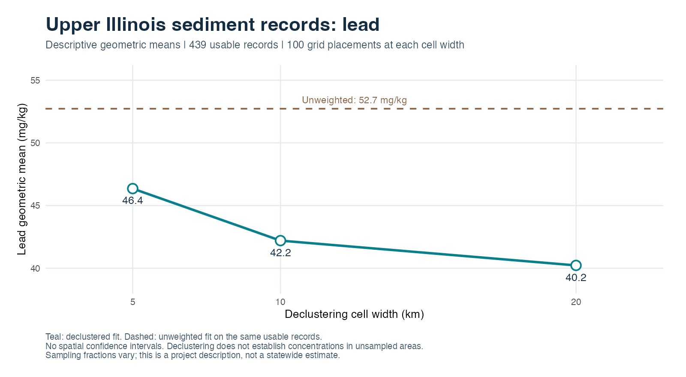
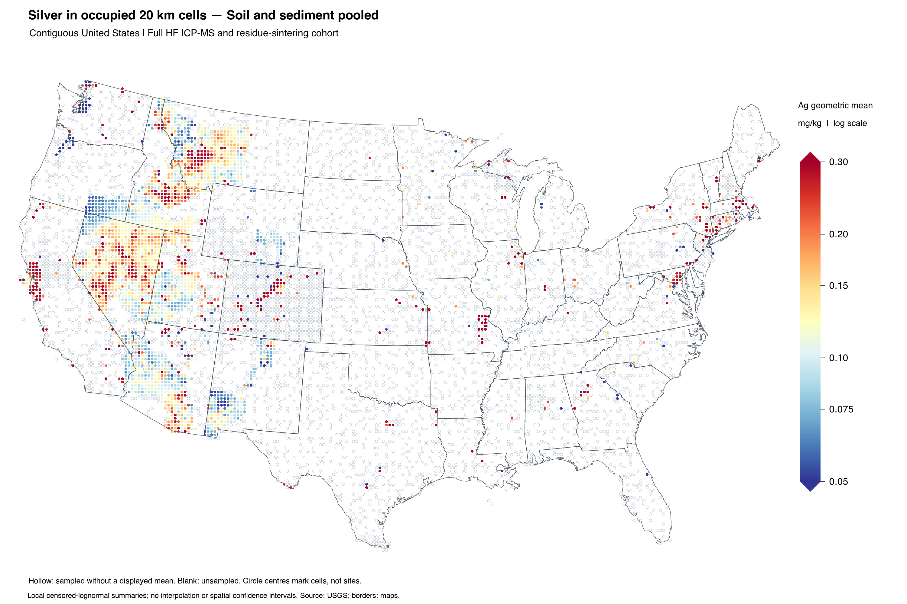

# geoCensor

[](https://github.com/diskoisland/geoCensor/actions/workflows/R-CMD-check.yaml)
[](https://github.com/diskoisland/geoCensor/releases)
[](LICENSE.md)

**Geochemical analysis that keeps detection limits, sampling context and uncertainty visible.**

geoCensor is an R package for USGS National Geochemical Database soil and sediment
exports. It retains results reported below or above analytical limits, fits
censoring-aware concentration models, and shows how spatial clustering changes
descriptive estimates. Analytical-method flags, missing metadata and unavailable
estimates remain visible throughout the workflow.

## Lead in Upper Illinois sediments



The same 439 usable records give different descriptive Pb estimates when dense
sampling clusters receive less influence. Sampling fractions vary within the
project, and analytical methods need review. These summaries describe the selected
records; they do not establish concentrations across unsampled terrain.

[Follow the Illinois lead and metals example](docs/examples/illinois-metals.md),
including cadmium, whose reporting limits leave much of its distribution unresolved.
The separate [Wisconsin sediment example](docs/examples/wisconsin-metals.md)
shows why semiquantitative methods and all-censored elements need explicit review.

## Silver across the US

The [national and state silver example](docs/examples/national-state-silver.md)
compares soil and sediment geometric means across declustering cell widths.
It includes downloadable aggregate results, figures and a reproduction script.
The national comparison uses 20, 40 and 80 km cells; state summaries retain
5, 10 and 20 km sensitivity. Missing estimates remain missing, and the guide
explains the limits imposed by censoring, analytical methods and sampling support.

The [HF ICP-MS silver maps](docs/examples/hf-icpms-ag-maps/README.md) provide a
downloadable CC0 cohort RDS and R code for pooled, soil and sediment maps in
fixed 20 km cells, with western close-ups. All six maps use the same
blue–yellow–red 0.05–0.30 mg/kg scale. Hollow cells keep unavailable local
estimates visible; no concentrations are predicted in unsampled areas.



## Start here

| Your task | Guide |
| --- | --- |
| Try the package without downloading data | [Small synthetic example below](#try-a-small-example) |
| Reproduce the sediment figures | [Inputs, script and output guide](docs/examples/README.md) |
| Compare national and state Ag estimates with spatial weights | [Silver declustering example](docs/examples/national-state-silver.md) |
| Explore 20 km Ag maps with a bundled, licensed data cohort | [HF ICP-MS map example](docs/examples/hf-icpms-ag-maps/README.md) |
| Run the full installed USGS workflow | [Synthetic workflow vignette](vignettes/usgs-workflow.Rmd) |
| Audit the Upper Illinois project across all species | [Installed case-study vignette](vignettes/illinois-case-study.Rmd) |
| Choose estimators and review assumptions | [Methods and function guide](docs/methods.md) |
| Inspect software checks and scientific limits | [Validation](docs/validation.md) |

## Install

Install the stable **1.2.0** tag from GitHub, including its required dependencies:

```r
install.packages("remotes") # once
remotes::install_github("diskoisland/geoCensor@v1.2.0")
```

Restart R after upgrading a loaded package. The [release page](https://github.com/diskoisland/geoCensor/releases/tag/v1.2.0)
also provides a built `.tar.gz` source installer with prebuilt vignettes, checksums
and a validation receipt. A review-bundle ZIP is not an R package installer.
An older local candidate also called itself 1.2.0; reinstall the published tag
if required workflows are missing.

## Try a small example

This is **synthetic chemistry**, provided only to demonstrate the API. Negative
`qvalue` values encode results below their absolute value; the `.1111` suffix encodes an
upper limit in this NGDB convention.

```r
library(geoCensor)

chemistry <- data.frame(
  lab_id = sprintf("sample_%02d", 1:12),
  species = "Pb", unit = "ppm", amethod = "MS_HF",
  qvalue = c("-5", "-5", "7", "10", "12", "15",
             "18", "21", "25", "30", "40", "45.1111")
)

lead <- build_element(chemistry, "Pb") # supported units converted to ug/kg
estimate <- fit_cen_lognorm(lead)
estimate[c("n_total", "n_left", "n_right", "geomean")]
```

With your own exports, use `read_usgs_chemistry()` to preserve identifiers,
qualifiers and reported numeric text. `analyze_elements()` runs across all reported
species. Spatial analysis additionally needs reviewed metadata and projected
coordinates. The [methods guide](docs/methods.md) covers joins, declustering,
distribution checks and installed command-line workflows.

## What the package supports

- Preserve left- and right-censoring instead of replacing nondetects with zero or
  a fraction of the limit. Retain the source text and the origin of recovered limits.
- Fit descriptive censored lognormal models and inspect alternative distributions.
- Audit analytical methods, sampling support, coordinate groups and join coverage.
- Compare cell-declustering scales on the same usable observations.
- Retain all reported species, missing information and unavailable estimates.

Ordinary model confidence intervals require the stated distributional and
independence assumptions. **Routine declustering-weighted confidence limits are
absent; spatial confidence procedures remain experimental.** Declustering alone
does not correct every preferential sampling mechanism. Concentration patterns
also need geological, sampling, analytical and human-activity context before
anomaly or source interpretation. See [validation](docs/validation.md).

## Data and reproducibility

Download the original sediment or soil exports separately from the
[USGS NGDB portal](https://mrdata.usgs.gov/ngdb/). The package contains no raw
geochemical database. The repository's HF ICP-MS map example separately includes
a selected CC0 cohort, with data rights, original qualifiers and source-row
identifiers. The examples identify their inputs, selection rules, methods and
limitations; their reproduction scripts save source-record indices,
configuration, software versions and checksums. The HF ICP-MS map example shows
soil and sediment separately and in an explicitly labelled pool; the other
workflows keep media separate.

## Citation and license

Use `citation("geoCensor")` for the installed package. Repository citation metadata
are in [CITATION.cff](CITATION.cff); changes are recorded in [NEWS.md](NEWS.md).

MIT license · Ross Edwards
