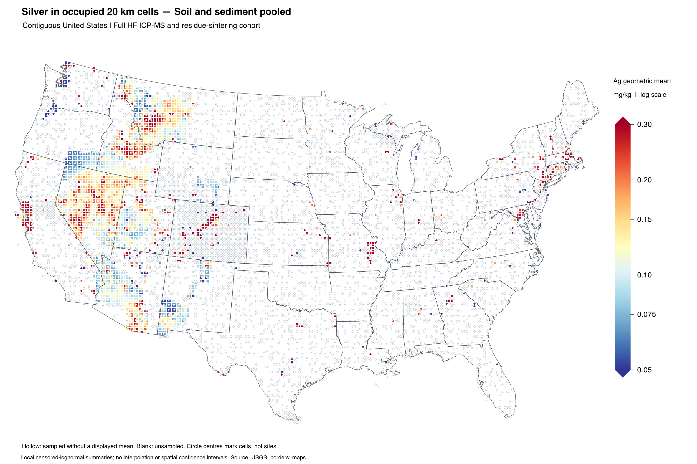
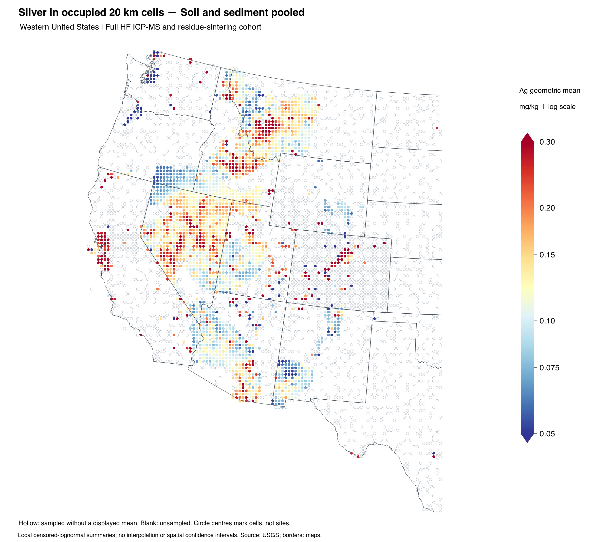
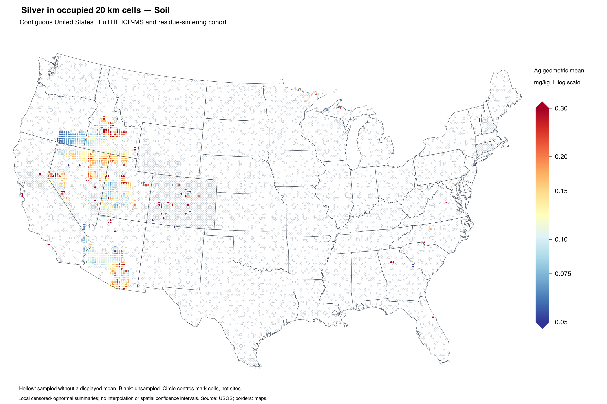
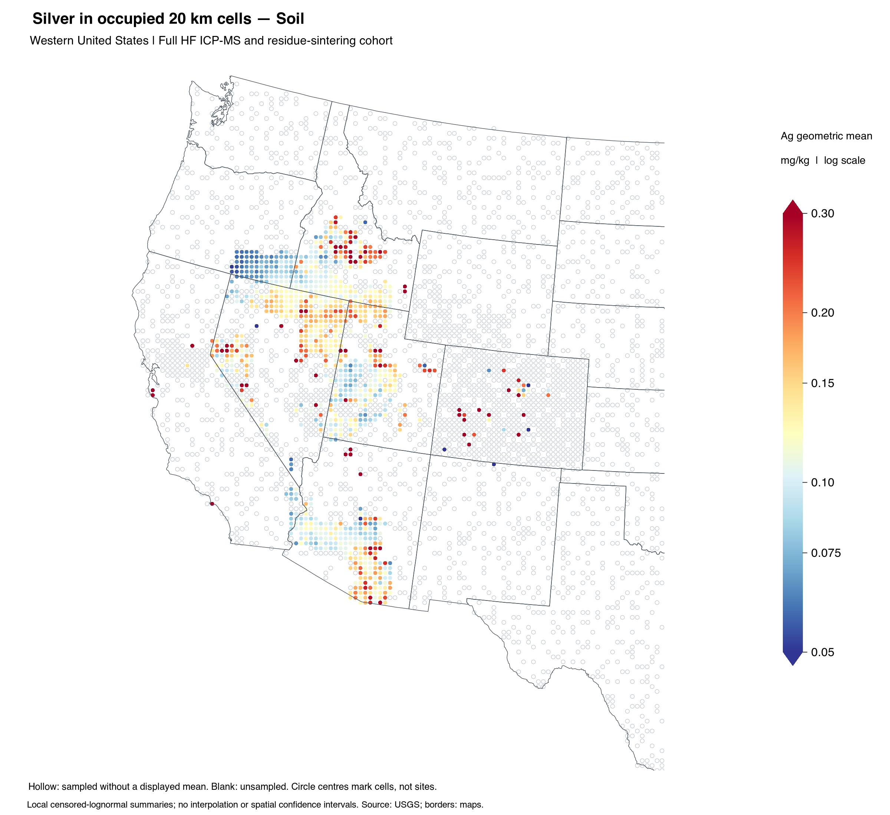
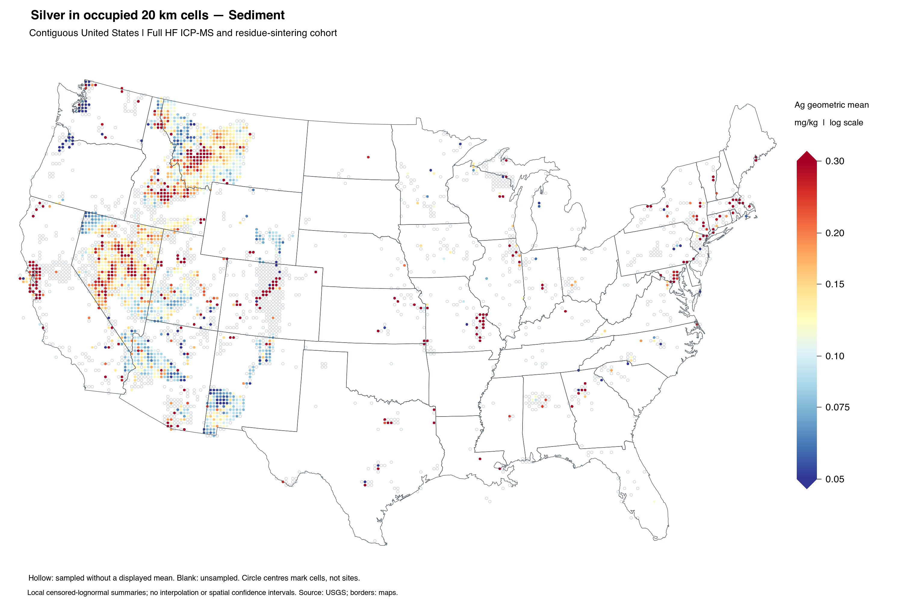
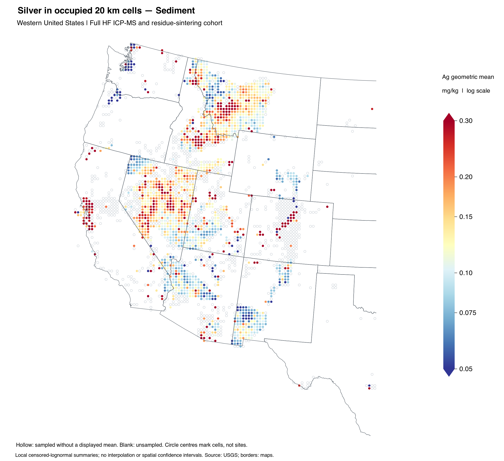

# Silver maps from HF ICP-MS and residue-sintering analyses

This example maps silver in the supplied USGS national geochemical archive,
using **20 km cells** and a shared **blue–yellow–red, logarithmic
0.05–0.30 mg/kg scale**. It includes the full pooled soil/sediment cohort and
separate soil and sediment maps. A western close-up accompanies each national
view. The cohort is provided as an RDS file, so trying the example requires no
new national database download.

[Download the cohort RDS](data.RDS) · [Reference cell results](reference-cells.RDS)
· [Data dictionary](DATA_DICTIONARY.md) · [Licensing](LICENSE-DATA.md)

These are descriptive, local **censor-aware geometric means**. The fixed-grid
map reduces visual dominance by dense sampling clusters, but uses equal assay
weights within each cell. It is distinct from the
[national and state multi-origin declustering workflow](../national-state-silver.md).
Neither grid aggregation nor declustering makes these targeted historical
surveys spatially representative.

## Pooled soil and sediment





## Soil





## Sediment





## Read the maps

Filled circles show fitted geometric means at grid-cell centres, rather than
individual sampling sites. Hollow circles mark sampled cells without a displayed
estimate. These include cells with no numerical observations and cells below the
display-support requirements. Blank areas have no retained reports in this
cohort. Neither hollow nor blank locations imply zero silver.

Values below 0.05 or above 0.30 mg/kg use the endpoint colours; their actual
estimates remain in the output tables. The colour endpoints are display choices,
not anomaly, toxicity or safety thresholds. No interpolation or spatial
confidence intervals are supplied.

| Contiguous U.S. view | Assay reports | Occupied cells | Coloured means | Hollow cells |
| --- | ---: | ---: | ---: | ---: |
| Soil and sediment pooled | 114,267 | 8,244 | 2,616 | 5,628 |
| Soil | 48,414 | 6,450 | 974 | 5,476 |
| Sediment | 65,853 | 3,618 | 1,905 | 1,713 |

The shared scale makes the figures visually comparable. Their sites, projects,
collection dates, depths, size fractions and analytical methods are not matched;
differences cannot be attributed to sample medium alone. These maps do not
establish statewide or national background concentrations.

## Run in R

Download or clone this repository, retaining the example folder and its files.
The additional mapping dependencies are:

```r
install.packages(c("sf", "maps", "jsonlite", "digest"))
```

For a quick redraw from verified cell summaries, run from the repository root:

```sh
Rscript docs/examples/hf-icpms-ag-maps/run.R output/ag_hf_redraw
```

The parent directory `output` must exist, and the chosen output directory must
be new. Use a different name for each run; partial outputs are kept if a check
fails. The script works from another working directory when given its full path.
Create the parent first with `dir.create("output", showWarnings = FALSE)` in R
if it is absent.

To refit every cell from the cohort, install
[geoCensor 1.2.0](https://github.com/diskoisland/geoCensor/releases/tag/v1.2.0)
and add `--refit`:

```sh
Rscript docs/examples/hf-icpms-ag-maps/run.R output/ag_hf_refit --refit
Rscript docs/examples/hf-icpms-ag-maps/check.R
```

The refit calls `geoCensor::fit_cen_lognorm()` on explicit values and censoring
bounds. An example-level multistart survival-regression refinement handles
narrow numerical clusters that can defeat the released API's default start.
The API result and its status are retained beside the refined result. Accepted
fits must pass likelihood-score, positive-curvature and multistart checks, and
all displayed means must reproduce the archived references within a relative
tolerance of 0.0001. This additional helper is repository example code, not a
new installed package function.

The output includes six PNG maps, three complete cell tables, original report
identities and cell memberships, an RDS of results, software versions and a
verification receipt. Quick mode redraws stored estimates and checks their
geometry/counts; `--refit` actually recomputes the concentration models.
The [reproduction checks](VALIDATION.md) record the completed full replay and
its limits.

## What is in data.RDS

```r
cohort <- readRDS("docs/examples/hf-icpms-ag-maps/data.RDS")
names(cohort)
head(cohort$chemistry)
head(cohort$metadata)
```

The full U.S./territories extract contains **119,490 assay reports**:
73,129 numerical-coded, 46,293 left-censored and 68 right-censored. Its three
populated methods are conventional four-acid HF ICP-MS (`MS_HF`, 68,190),
ultratrace four-acid HF ICP-MS (`MS_HF_UT`, 51,250), and HF digestion followed by
sodium-peroxide sintering of the residue (`MS_HFST`, 50). All 50 residue-sintering
reports occur in the mapped sediment subset. `MS_AZ_HF` is also eligible by its
method description but supplies no soil/sediment Ag reports in this snapshot.

The selection has **no ≤0.5 mg/kg nominal reporting-limit restriction** and no
filter on fraction, sieving, grinding, depth, carbon or sample mass. Source ppm
is numerically mg/kg; no dry-mass or material-basis conversion is inferred.
Reanalyses remain assay reports, and alternate native releases are not appended
as additional observations. Counts are not independent field sites.

Original chemistry values, qualifiers, methods, units, source identifiers and
reviewed bounds are preserved. `N`, `L` and `<` retain their different meanings.
Actual censoring bounds enter the likelihood; they are not replaced with zero,
half the reporting limit, or nominal method limits. See the
[data dictionary](DATA_DICTIONARY.md).

## Grid and display rules

The grid has a fixed zero origin in a custom WGS84 Albers equal-area projection
with central longitude −96°, latitude of origin 23° and standard parallels
29.5° and 45.5°. This is not labelled EPSG:5070, which uses a different datum.
Indices are `floor(x / 20000)` and `floor(y / 20000)`, including negative
coordinates. Circles have a 16 km diameter and represent 20 × 20 km cells.
State lines do not define the cells.

Display requires at least six assay reports, two distinct numerical values and
three reported coordinate pairs. Numerical score and curvature checks follow.
These are descriptive display conventions, not validated reliability thresholds.
An all-censored cell remains unavailable. The map does not allocate censored
mass from a global model or predict concentrations in unsampled cells.

## Sources and permission to reuse

The selected USGS dataset is publicly marked **CC0 1.0 Universal**, permitting
redistribution. The R code uses the repository's MIT license; `maps` is a
separate GPL-2 dependency. State-boundary data are not included in the cohort
RDS and are not claimed to be CC0. See [data licensing](LICENSE-DATA.md) for the
source links, scope and attribution.

**Direct geochemical data source**

Granitto, M.; Goldman, M. A.; Labay, K.; San Juan, C. A.; Azain, J. S.; Rozinek,
T. R. *Geochemical Data for Rock, Sediment, Soil, and Mineral Samples, United
States and Territories, 1962 to 2023*. U.S. Geological Survey data release,
2026. [DOI 10.5066/P1FXE9GK](https://doi.org/10.5066/P1FXE9GK).

The input is the supplied Parquet snapshot labelled **18 November 2025**.
The current January 2026 catalogue citation does not establish identical bytes
with a later remote download. `manifest.json` binds the bundled files by SHA256;
the RDS also records the original source-table names and hashes. Chemistry and
geology row ordinals, lab IDs and group IDs support lookup in that snapshot.
Metadata are a documented subset, not a copy of every archive field.

**Boundary source**

Becker, R. A.; Wilks, A. R.; Brownrigg, R.; Minka, T. P.; Deckmyn, A. *maps:
Draw Geographical Maps*. R package version 3.4.3, 2025.
[DOI 10.32614/CRAN.package.maps](https://doi.org/10.32614/CRAN.package.maps).
The run records the installed version; an updated boundary database may alter
the outline without changing cohort cells or estimates.

**Related dataset documentation**

The archive bibliography includes the following useful context. These are not
blanket report-level attributions, and no second copy of these releases is
merged into the cohort:

- Smith, D. B.; Cannon, W. F.; Woodruff, L. G.; Solano, F.; Kilburn, J. E.; Fey,
  D. L. *Geochemical and Mineralogical Data for Soils of the Conterminous United
  States*. USGS Data Series 801, 2013.
  [DOI 10.3133/ds801](https://doi.org/10.3133/ds801).
- Smith, S. M.; Azain, J. S.; Bueghly, Z. C.; Olinger, D. A. *Reanalysis of
  Selected Archived NURE-HSSR Sediment and Soil Samples from Arizona, California,
  Idaho, Montana, Nevada, New Mexico, and Utah*. USGS data release, 2018;
  ver. 8.0, May 2021, as cited in the supplied archive.
  [DOI 10.5066/F7765DHF](https://doi.org/10.5066/F7765DHF).
- Smith, S. M.; Azain, J. S.; Bueghly, Z. C.; Ingraham, A. D. *Reanalysis of
  Additional Selected Archived NURE-HSSR Sediment Samples from Idaho and
  Montana*. USGS data release, 2021.
  [DOI 10.5066/P9XFFORC](https://doi.org/10.5066/P9XFFORC).

Exact project-to-publication attribution remains incomplete. A project label,
lab code or general method citation alone does not establish a specific
sampling design, digestion completeness, laboratory batch or field event.

[All examples](../README.md) · [Methods](../../methods.md) · [Validation](../../validation.md)
