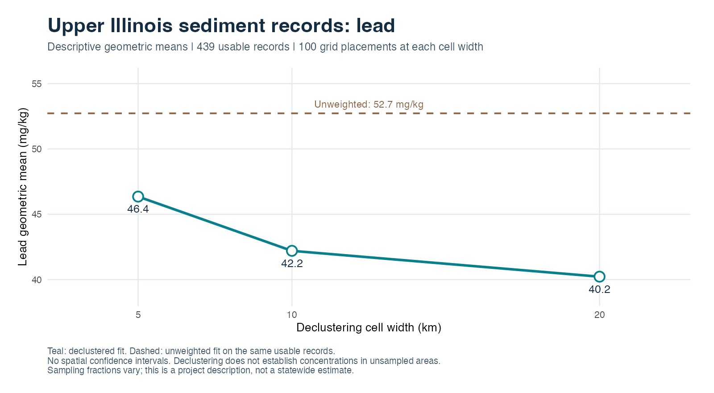
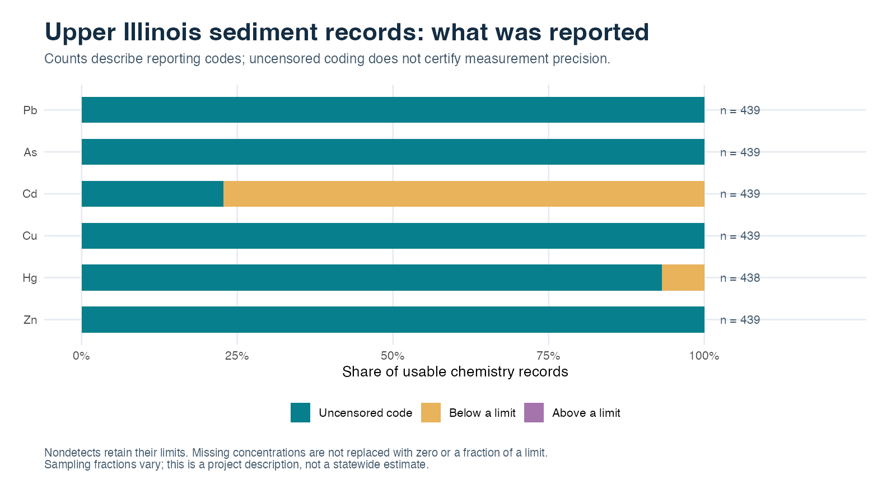

# Lead and other trace elements in Upper Illinois sediments

This example asks two practical questions: how much do clustered observations
influence a descriptive concentration estimate, and how much information remains
unresolved by reporting limits? Lead illustrates the first question. Cadmium
illustrates the second. Both use the same metadata-selected project cohort.

## The selected records

The selection is `state == IL` and project label `NAWQA Upper Illinois R. Basin`
in the sediment metadata export. No concentration, detection or fitted result
is used to choose the cohort. All chemistry belonging to its sample IDs is retained.

| Inventory item | Count |
| --- | ---: |
| Metadata records | 439 |
| Best-value chemistry records | 20,422 |
| Reported species | 48 |
| Records with numeric geographic coordinates | 439 |
| Distinct recorded coordinate pairs | 332 |
| Available collection dates | 0 |

These are records and coordinate groups, not certified counts of physical sites
or independent specimens. Metadata classify the samples as sediment; 437 records
name a stream/river source and two leave it missing. Grain-size and collection
text vary: composite descriptions, field sieving and laboratory sieving occur in
the cohort. They are not silently combined into a common sediment fraction.

## How clustering changes the lead summary

| Cell width | Unweighted Pb (mg/kg) | Declustered Pb (mg/kg) |
| --- | ---: | ---: |
| 5 km | 52.7 | 46.4 |
| 10 km | 52.7 | 42.2 |
| 20 km | 52.7 | 40.2 |

Every comparison uses the same 439 usable Pb/coordinate records. Each occupied
cell receives equal total influence, shared among its records; weights are
averaged over 100 deterministic placements at each of the three fixed cell widths.
The widths are sensitivity choices, not an estimated geological range or a search
for the smallest concentration. Coordinates are transformed from the published
WGS84 fields to EPSG:5070 metres without correcting the original locations.

Declustering reduces the descriptive influence of dense sampling. These fits
require a lognormal working model and reviewed analytical inputs. Variable sample
fractions and unresolved method information limit interpretation. The result
does not supply concentrations for unsampled terrain, a statewide background,
a contamination diagnosis or a spatial confidence interval.

## Censoring differs among the elements

| Element | Usable records | Uncensored code | Below a limit | Above a limit |
| --- | ---: | ---: | ---: | ---: |
| Pb | 439 | 439 | 0 (0.0%) | 0 |
| As | 439 | 439 | 0 (0.0%) | 0 |
| Cd | 439 | 100 | 339 (77.2%) | 0 |
| Cu | 439 | 439 | 0 (0.0%) | 0 |
| Hg | 438 | 408 | 30 (6.8%) | 0 |
| Zn | 439 | 439 | 0 (0.0%) | 0 |

All Pb values are coded as uncensored. That does not certify measurement precision.
Cd has only 100 uncensored records and 339 left-censored records; substituting
zero or half a limit would assign concentrations that were never reported.
Hg has one fewer input record; the absent observation is not filled in.

The reproduction script also saves empirical CDF bounds. These describe the range
of cumulative fractions compatible with the coded observations and limits using
equal record weights. They are not population confidence bands or spatial
uncertainty estimates. Original method flags remain attached; a method that is
not flagged as semiquantitative has not automatically been cleared as quantitative.

The full results retain all 48 species. Au, Bi, Eu, Ho and Ta have unavailable
geometric means under all-left censoring. They remain in the result tables.

## Reproduce and interpret

Use the [reproduction guide](README.md) and [R script](sediment-metals.R).
The [six-element summary](illinois-summary.csv) is derived from the preserved
inputs; the script saves every reported species, source records, indices,
method/support tables and software provenance to the user's output directory.
Units in these figures are mg/kg; the analysis API stores converted values in
ug/kg. No missing dry-weight basis or dilution factor is inferred.

For historical scientific context, see the [USGS Upper Illinois fine-fraction
sediment study](https://doi.org/10.3133/wri984109) and its [geochemical data
report](https://doi.org/10.3133/ofr90571). Those reports describe survey design and
sample support; this workflow has not reconciled individual NGDB records to their
field-site or QA identifiers. The publications' collection years are not copied
into the missing NGDB dates. Such reconciliation is a next step before source,
land-use or temporal interpretations.

[Wisconsin example](wisconsin-metals.md) · [Validation and limits](../validation.md) · [Project](../../README.md)
