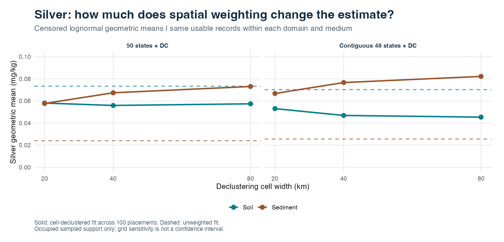
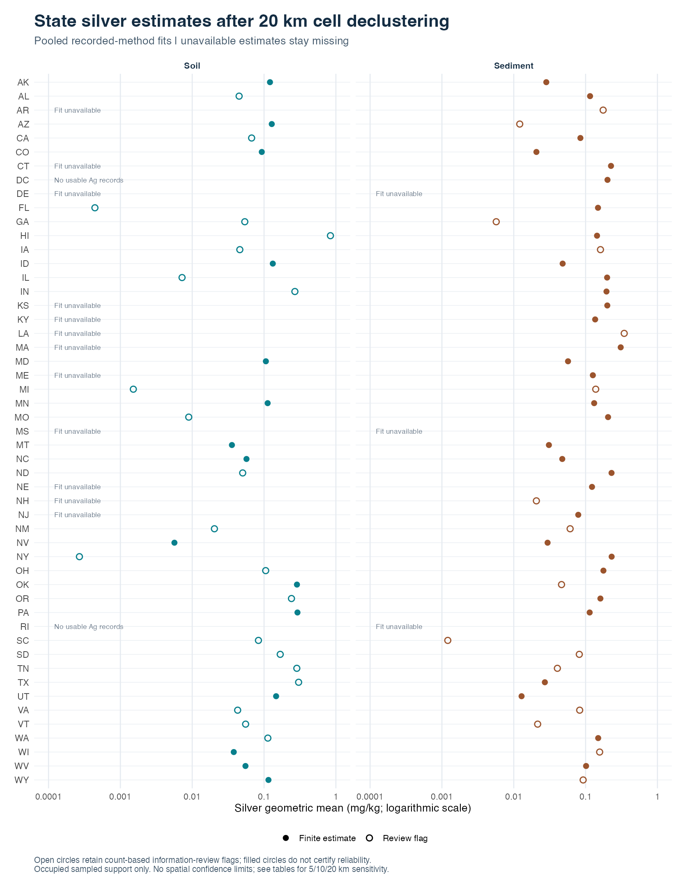

# Silver in US soil and sediment: spatial declustering

Dense sampling can give a small area disproportionate influence over a national
or state summary. This example uses silver (Ag) to show how cell declustering
changes descriptive estimates while retaining results reported below or above
analytical limits. Soil and sediment are analyzed separately.

You can inspect the [national grid results](data/silver-national-grid.csv),
[state results](data/silver-state-summary.csv) and
[source provenance](data/source-provenance.json) without downloading the
underlying database. The [reproduction script](national-state-silver.R) uses
separately downloaded USGS exports; no individual sample records are bundled
for this older workflow. The separate [HF ICP-MS map example](hf-icpms-ag-maps/README.md)
provides its own licensed cohort and has a different selection and purpose.
The displayed results were calculated on November 5, 2026 with geoCensor 1.2.0.
They are exports of that completed analysis; publishing this example did not
rerun the full national and state study.

## What the weights do

At each grid placement, every occupied cell receives the same total weight.
Records in a cell share that weight. We average each record's weights across
100 deterministic placements, then fit a censored lognormal distribution with
those averaged weights. We do not average 100 fitted means.

A densely sampled cell consequently has the same total influence as a sparsely
sampled cell. Unoccupied cells contribute no observations. These weights describe
the **occupied sampling footprint**, not the concentration throughout all land
in a state or the United States. Coincident coordinate pairs are not certified
independent sites, and declustering does not make observations independent.

The geometric mean, `exp(mu)`, describes the fitted lognormal distribution's
typical concentration and equals its median. The arithmetic model mean is
`exp(mu + sigma^2 / 2)`. Both use the reported censoring intervals; neither
replaces nondetects with zero, half a detection limit or a detected-only average.

## National sensitivity to cell width



These are pooled recorded-method estimates in **mg/kg**. `US50_DC` includes the
50 states and District of Columbia. `CONUS` includes the contiguous 48 states
and District of Columbia. Membership follows the source country and state
labels; coordinates are not used to infer jurisdiction.

| Domain | Cell width | Soil geometric mean | Sediment geometric mean |
| --- | ---: | ---: | ---: |
| US50_DC | 20 km | 0.05812 | 0.05773 |
| US50_DC | 40 km | 0.05595 | 0.06741 |
| US50_DC | 80 km | 0.05743 | 0.07310 |
| CONUS | 20 km | 0.05309 | 0.06675 |
| CONUS | 40 km | 0.04690 | 0.07668 |
| CONUS | 80 km | 0.04538 | 0.08223 |

The corresponding unweighted geometric means are 0.07338 mg/kg for soil and
0.02401 mg/kg for sediment in US50_DC; CONUS values are 0.07025 and
0.02561 mg/kg. Weighted and unweighted fits use the same usable, located
records. The US50_DC cohort contains 86,508 soil results at 54,062 reported
coordinate pairs and 287,241 sediment results at 242,580 pairs. CONUS contains
81,910 soil and 203,106 sediment results.

Soil changes relatively little across these three national widths, while
sediment continues to rise. Neither behavior identifies a universally correct
cell width. Regional patterns can move in opposite directions and cancel in a
national curve. Report **20, 40 and 80 km together**; the 40 km column is a
provisional comparison reference, not an optimized width or validated geological
background. Grid sensitivity is not a confidence interval.

The national calculation uses separate projected components: CONUS in EPSG:5070,
Alaska in EPSG:3338, and Hawaii in a fixed WGS84 Lambert azimuthal equal-area
projection centered at 20.5° N, 157° W. Cells in different components have
distinct identities. At each placement, occupied cells across all included
components receive equal mass. National results are **not averages of state
means** and states do not receive equal total weight.

## State examples and unavailable estimates



The state table retains all 50 states and DC for each medium: 102 rows. Its
declustering widths are **5, 10 and 20 km**. For example:

| State | Medium | Unweighted GM | 5 km GM | 10 km GM | 20 km GM |
| --- | --- | ---: | ---: | ---: | ---: |
| California | Soil | 0.09702 | 0.06140 | 0.06330 | 0.06716 |
| California | Sediment | 0.03561 | 0.05783 | 0.07290 | 0.08463 |
| Idaho | Soil | 0.20371 | 0.15042 | 0.14242 | 0.13235 |
| Idaho | Sediment | 0.04754 | 0.02466 | 0.03199 | 0.04791 |
| Wisconsin | Soil | 0.07003 | 0.01903 | 0.02709 | 0.03789 |
| Wisconsin | Sediment | 0.08098 | 0.13325 | 0.14506 | 0.15687 |

All entries are mg/kg. State calculations use per-medium WGS84 equal-area
projections centered on the median longitude and latitude of all explicitly
US-labelled metadata for each state, before selecting Ag records. Those
definitions are held fixed during analysis. The grid origin is anchored to each
selected domain's minimum projected coordinates. The national grid uses a fixed
projected origin of `(0, 0)` shared by the two media. This difference can change
an estimate even at the same 20 km width; the two tables are not a test of
state boundaries alone. State 40/80 km estimates are not supplied here.

An unavailable fit remains `NA`. Kansas soil has 100 usable results but only
one uncensored-coded value; Nebraska soil has 162 results, all left-censored.
Their model estimates are unavailable. Texas soil does have a finite estimate,
but only 11 of 388 values are uncensored-coded, carrying about 0.31% of the
20 km weight. Oregon soil has only three uncensored-coded values among 2,354
records and changes substantially with cell width. Finite estimates and
minimum-count checks do not establish reliable background concentrations.

Rows with no reported Ag and rows with measurements but unavailable fits have
separate status fields. Neither means zero silver. The workflow does not
substitute a national value for an unavailable state estimate.

For example, read the public summary from the repository root in R:

```r
silver <- read.csv("docs/examples/data/silver-state-summary.csv",
                   na.strings = c("NA", ""))
subset(silver, state == "WI", select = c(
  medium, n_usable, geomean_unweighted_mgkg,
  geomean_5km_mgkg, geomean_10km_mgkg, geomean_20km_mgkg,
  information_review_20km
))
```

## Measurement and model limits

More than 90% of the national records are censored. After CONUS 40 km weighting,
only 3.44% of soil weight and 6.55% of sediment weight lies on uncensored-coded
results. Uncensored source coding does not certify analytical precision,
particularly for semiquantitative methods.

Analytical methods are pooled only as a labelled descriptive reference. Changes
in weights can also change their mixture. Method cohorts have different
locations, detection limits and sampling histories; their differences do not
provide an analytical calibration. Soil horizons, depths and size fractions are
not harmonized. The sediment cohort includes stream/river, marine and other
reported sediment types.

The tables retain arithmetic model means and the minimum/maximum arithmetic
means compatible with the weighted reported intervals. Some fitted arithmetic
means fall below the corresponding sample lower bound. A model expectation
and a realized sample bound are different targets, so this is a high-tail
adequacy warning rather than a mathematical contradiction. **Do not use these
arithmetic model means as validated national means or metal-load estimates.**
Nonfinite or physically inadmissible arithmetic model moments remain unavailable
with explicit statuses; no observation or detection limit is clipped.

No spatial confidence limits are calculated. The example demonstrates spatial
weighting, censoring-aware fitting and sensitivity reporting. It does not
establish unbiased population estimates, geological causes, contamination
sources or validated correction of every preferential sampling mechanism.

## Reproduce with your own USGS exports

Install the released package and the additional projection dependency, then
restart R:

```r
install.packages("remotes") # if needed
remotes::install_github("diskoisland/geoCensor@v1.2.0")
install.packages("sf") # if needed
```

To try the workflow without downloading a database, run its small synthetic
check from the repository root:

```sh
Rscript docs/examples/check-national-state-silver.R
```

To regenerate the two public figures using only the bundled aggregate tables
and `ggplot2`:

```sh
Rscript docs/examples/plot-national-state-silver.R
```

Download the native soil and sediment `main.csv` and `bestvalue.csv` exports
separately from the [USGS NGDB portal](https://mrdata.usgs.gov/ngdb/). Retain the
source version and download provenance. The example uses the legacy NGDB
best-value exports, not every analysis in the larger unified USGS database.
The [provenance file](data/source-provenance.json) identifies the tested source
snapshots. A different snapshot can legitimately produce different counts and
estimates.

From a downloaded or cloned copy of this repository:

```sh
mkdir -p output
Rscript docs/examples/national-state-silver.R \
  /path/to/ngdbsoil/main.csv /path/to/ngdbsoil/bestvalue.csv \
  /path/to/ngdbsed/main.csv /path/to/ngdbsed/bestvalue.csv \
  output/silver_example
```

Quote paths containing spaces. Use a new output directory whose parent already
exists. Retained source records and analysis outputs belong in an ignored local
directory. The public tables contain aggregate results only.

For each medium, the new script writes `state_summary.csv` and
`national_summary.csv` in long form: each row describes one unweighted basis or
declustering width. The public 102-row state CSV is a wide presentation export
of the completed November 5 analysis, with multiple widths in columns; it is not
the new script's verbatim output format.

The reproduction script records selection, projections, grid settings, software
versions and input fingerprints. Keep these with the generated estimates.
The new workflow has been checked with synthetic inputs and independent
geometry and likelihood calculations. Those checks do not constitute a fresh
full-data replay of the published national and state numbers.
Changes to projection software or available datum operations can move points
near cell boundaries; numerical reproduction is distinct from source-position
accuracy or statistical validation.

[All examples](README.md) · [Methods](../methods.md) ·
[Validation and scientific limits](../validation.md) · [Project](../../README.md)
