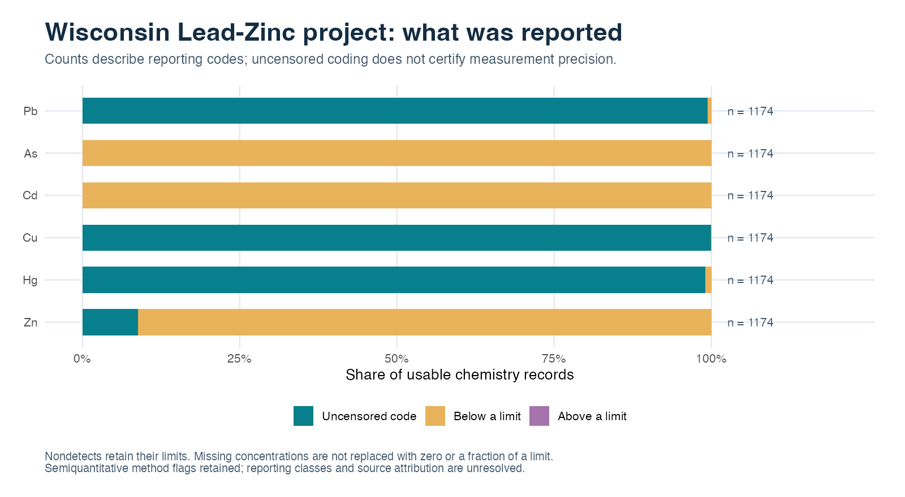

# Wisconsin sediment records: method review before interpretation

The NGDB project label **Wisconsin Lead-Zinc** supplies a second, separate
sediment example. It demonstrates why a successful numerical workflow must
preserve semiquantitative method flags and unavailable all-censored estimates.
Its selection is the recorded state `WI` and that exact project label, with no
selection on concentrations. It is not a probability sample of all Wisconsin.

## The selected records

| Inventory item | Count |
| --- | ---: |
| Metadata records | 1,174 |
| Best-value chemistry records | 36,396 |
| Reported species | 32 |
| Records with numeric geographic coordinates | 1,174 |
| Distinct recorded coordinate pairs | 1,172 |
| Available collection dates | 0 |

The metadata classify all records as sediment collected as single/grab samples.
The recorded source is stream/river for 1,171 records and spring for three.
These source labels are retained separately; a spring record is not relabeled as
a stream sample. A grain-size fraction is not supplied in the dedicated fields. Much of
`addl_attr` records legacy coordinate text; it is not treated as a sediment-size
classification or used to reconstruct an undocumented coordinate reference system.
The workflow uses only the published WGS84 fields for projection. Missing dates,
fraction information and field/lab QA remain unknown.

## What the reporting codes resolve

| Element | Usable records | Uncensored code | Below a limit | Above a limit |
| --- | ---: | ---: | ---: | ---: |
| Pb | 1174 | 1167 | 7 (0.6%) | 0 |
| As | 1174 | 0 | 1174 (100.0%) | 0 |
| Cd | 1174 | 0 | 1174 (100.0%) | 0 |
| Cu | 1174 | 1173 | 1 (0.1%) | 0 |
| Hg | 1174 | 1163 | 11 (0.9%) | 0 |
| Zn | 1174 | 104 | 1070 (91.1%) | 0 |

All As and Cd records are left-censored, so their geometric means remain
**unavailable**. Their limits are retained; no representative concentration is
assigned. Zn is about 91% left-censored and its fitted description is particularly
dependent on modeling assumptions and the small uncensored fraction.

For Pb, As, Cd, Cu and Zn, every retained record has the `ES_SQ` method code,
which geoCensor flags as semiquantitative. Even the 1,167 uncensored-coded Pb
records retain that flag. The package does not reconstruct reporting-class ranges
from the method name. Hg uses a different method code, which still needs review;
absence of a semiquantitative flag is not a certificate of analytical quality.

The script retains working-model results across all 32 species and fixed
5/10/20 km declustering scales. The [selected-element summary](wisconsin-summary.csv)
keeps method status and unavailable values explicit. These numerical descriptions
are not validated ore-grade probabilities, contamination diagnoses or calibrated
spatial inference. The lead results are not ranked against Illinois: the two
project cohorts have different support and analytical contexts.

## What would make this case more informative?

Recover project documentation, analytical reporting classes, field/lab QA, sample
fractions and collection dates where they genuinely exist. Reconcile these to the
record identifiers before applying geological, mining-history or other human-
activity context. With the present information, the case is an example of honest
reporting and prioritizing follow-up questions.

[Reproduction guide](README.md) · [R script](sediment-metals.R) · [Illinois example](illinois-metals.md) · [Validation](../validation.md)
